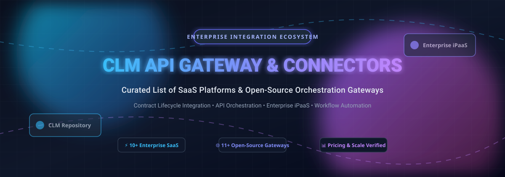

# Awesome CLM API Gateway & Connectors 🚀

<p align="center">
  
</p>

<p align="center">
  <a href="https://github.com/ishandutta2007/Awesome-Awesome-Awesome"></a>
  <a href="https://discord.gg/jc4xtF58Ve"></a>
  <a href="https://github.com/ishandutta2007/Awesome-CLM-API-Gateway-Connectors/stargazers"></a>
  <a href="https://github.com/ishandutta2007/Awesome-CLM-API-Gateway-Connectors/network/members"></a>
  <a href="https://github.com/ishandutta2007/Awesome-CLM-API-Gateway-Connectors/issues"></a>
  <a href="https://github.com/ishandutta2007/Awesome-CLM-API-Gateway-Connectors/blob/main/LICENSE"></a>
  <a href="https://github.com/ishandutta2007"></a>
</p>

---

## 🌟 Top CLM API Gateway & Connectors Ecosystem

> **A curated collection of leading SaaS platforms and open-source API gateways, connector frameworks, and integration orchestration platforms for Contract Lifecycle Management (CLM).**  
> *Focusing on automated contract data pipelines, API orchestration, enterprise connectivity (CRM, ERP, HCM, Procurement), and webhook event routing.*  
> **📅 Last updated: March 2026**

This repository tracks notable **SaaS platforms** and **open-source projects** for **CLM API Gateways & Connectors**. Modern organizations require seamless integration between contract lifecycle management solutions (such as Icertis, DocuSign, Conga, Sirion, Ironclad, and PandaDoc) and downstream enterprise applications (Salesforce, SAP, NetSuite, Workday, ServiceNow). These tools eliminate point-to-point bespoke integrations by offering managed connectors, standardized API mediation, identity-aware authorization (OAuth 2.0 / mTLS), and resilient workflow automation.

### 🎯 Key Architectural Use Cases
- 🔄 **Bidirectional Metadata Synchronization**: Seamless syncing of contract fields, obligations, and milestone dates between CLM repositories and core CRM/ERP records.
- ⚡ **Event-Driven Lifecycle Triggers**: Automated webhook ingestion and message distribution when contracts transition across drafting, negotiation, signature, and renewal stages.
- 🛡️ **Zero-Trust API Security & Governance**: Enforcing OAuth 2.0 token introspection, rate-limiting, least-privilege RBAC, and immutable audit trails across all contract endpoints.
- 🤖 **AI & LLM Integration Proxies**: Routing contract metadata to LLMs, extraction models, and MCP (Model Context Protocol) servers without exposing raw credentials.

---

## 📑 Table of Contents
- [📊 Sector Overview & Market Dynamics](#-sector-overview--market-dynamics)
- [☁️ SaaS & Hosted Enterprise Platforms](#️-saas--hosted-enterprise-platforms)
- [💻 Open-Source GitHub Projects](#-open-source-github-projects)
- [🏗️ Recommended Architecture Stacks](#️-recommended-architecture-stacks)
- [🤝 How to Contribute](#-how-to-contribute)
- [📈 Star History](#-star-history)
- [💖 Support & Sponsorship](#-support--sponsorship)
- [⚖️ Disclaimer](#️-disclaimer)

---

## 📊 Sector Overview & Market Dynamics

The enterprise software market for **Contract Lifecycle Management (CLM)** is estimated between **$2.5B and $3.3B**, rapidly scaling toward **$7B to $11B+** by the early 2030s at an estimated **12%–14% CAGR**. Simultaneously, the **Integration Platform as a Service (iPaaS)** backbone that powers cross-system orchestration is valued between **$11B and $19B**, compounding at **24%–30%+ CAGR** due to enterprise multi-cloud sprawl and AI-agent automation.

```
       ┌────────────────────────┐         ┌────────────────────────┐
       │   Enterprise CRMs      │         │     Enterprise ERPs    │
       │ (Salesforce, HubSpot)  │         │   (SAP, NetSuite)      │
       └───────────▲────────────┘         └───────────▲────────────┘
                   │                                  │
                   └──────────────┐    ┌──────────────┘
                                  ▼    ▼
                       ┌──────────────────────┐
                       │  API Gateway / iPaaS │ ◄── [OAuth 2.0 / Webhooks]
                       │ (Kong, MuleSoft, n8n)│
                       └──────────▲───────────┘
                                  │
                                  ▼
                       ┌──────────────────────┐
                       │    CLM Platforms     │
                       │ (Icertis, DocuSign)  │
                       └──────────────────────┘
```

The sector is **moderately to highly fragmented** rather than winner-take-all:
1. **No Monopolistic Lock-In**: While legacy giants like MuleSoft (Salesforce), Microsoft Power Automate, and Boomi retain massive enterprise shares, dozens of high-growth automation vendors (Workato, Zapier, Make, Tray.ai) and self-hosted open-source gateways (n8n, Kong, Traefik) provide continuous market contestability.
2. **AI-Native Disruption**: A wave of AI-native contract tooling and low-code integration frameworks prevents static vendor consolidation, prompting platform teams to prefer composable, multi-vendor API gateway architectures.

---

## ☁️ SaaS & Hosted Enterprise Platforms

Curated list of commercial enterprise iPaaS and hosted gateway connectors, **sorted descending by company scale (valuation / market capitalization / ARR)**:

| Product | 🏢 Company Scale (Valuation / Revenue) | 💰 Starting Tier Pricing | 🎁 Free Tier / Trial Limits | 📝 Description |
|---|---|---|---|---|
| **[Microsoft Power Automate](https://powerautomate.microsoft.com/)** | ~$3.1T Market Cap (Parent Microsoft) / $245B+ Annual Revenue | **$15/user/month** (Power Automate Premium) or **$0.60/execution** (pay-as-you-go attended) | **90-day free trial** of Power Automate Premium with full connector capabilities; permanent free plan limited to basic desktop/standard cloud connectors (excludes premium CLM connectors) | Workflow automation with pre-built CLM connectors (DocuSign, Adobe Acrobat Sign, SharePoint). |
| **[MuleSoft Anypoint Platform](https://www.mulesoft.com/)** | ~$300B+ Market Cap (Parent Salesforce) / $6.5B acquisition valuation (~$1.5B+ ARR) | **$2,000/month** ($24,000 billed annually for entry tier) | **30-day free trial** with CloudHub worker allocation (limited to 0.1 vCore testing runtime); no perpetual free tier | Enterprise iPaaS and API management with certified CLM connectors for Icertis, DocuSign, and Conga. |
| **[Workato](https://www.workato.com/)** | **$5.7B** Valuation (Series E) / ~$150M ARR | **$75/month** (Pro plan, includes 2,500 credits; additional credits at $0.03/credit) | **Workato Free plan**: 50,000 one-time credits (never expire), full access to 1,000+ connectors; no recurring monthly refill | Low-code enterprise automation platform with pre-built CLM connectors, recipes, and API orchestration. |
| **[Zapier](https://zapier.com/)** | **$5.0B** Valuation / ~$350M+ ARR | **$19.99/month** (Professional plan billed annually for 750 tasks/mo) | **Free forever plan**: 100 tasks/month, 2-step single-trigger Zaps, 15-minute polling interval; **14-day Pro trial** with 1,000 tasks | No-code automation connecting 7,000+ web applications including CLM tools (DocuSign, PandaDoc, Concord). |
| **[Icertis API Integration Gateway](https://www.icertis.com/)** | **$5.0B** Valuation / ~$320M+ ARR | **$100,000/year** (typical enterprise baseline subscription; ~$150–$350/user/month equivalent) | **No self-service free tier or automated trial**; custom guided sandbox demos provided upon qualified sales evaluation | Dedicated REST API gateway for the Icertis Contract Intelligence platform with OAuth 2.0 and SSO support. |
| **[Boomi](https://www.boomi.com/)** | **$4.0B** Acquisition Valuation (TPG & Francisco Partners) / ~$500M+ Revenue | **$99/month** (Pay-As-You-Go tier + ~$0.05/message) or **$20,000/year** (Professional edition) | **30-day free trial** of Boomi Enterprise Platform with access to integration builder and core connectors; no permanent free tier | Cloud-native iPaaS with API Control Plane managing multi-vendor gateways and AI-assisted data routing. |
| **[SnapLogic](https://www.snaplogic.com/)** | **$1.0B** Valuation (Unicorn status) / ~$150M+ Revenue | **$10,000/year** (Developer/Starter package baseline; typical mid-market $86,000+/year) | **30-day free trial** for specific tools (Fast Data Loader); platform evaluation available via guided sales PoC | Generative-integration iPaaS with Snaps for CLM, ERP, CRM, and API management. |
| **[Tray.io (Tray.ai)](https://tray.ai/)** | **$600M** Valuation / ~$71M Revenue | **$50/month** (base platform entry; typical production Pro starts ~$500/month) | **30-day free trial** with up to **1,000,000 tasks** and full connector library access; no permanent free tier | Enterprise low-code iPaaS and Merlin AI Agent builder with 700+ connectors and MCP gateway add-ons. |
| **[Jitterbit](https://www.jitterbit.com/)** | ~$200M Valuation (KKR backed) / ~$85M Revenue | **$1,000/month** ($12,000/year annual contract for Standard tier) | **14-day free trial** for non-production evaluation with manual project export; no permanent free tier | Enterprise iPaaS offering an "Unlimited" connection model across iPaaS, API Manager, EDI, and App Builder. |
| **[Celigo](https://www.celigo.com/)** | ~$150M Valuation / ~$90M ARR | **$600/month** ($7,200/year starting flow tier; median enterprise contract ~$14,787/year) | **Free forever plan**: 2 endpoints, 1 active flow in production; **30-day free trial** with unlimited endpoints and flows | iPaaS optimized for business application and CLM integration with pre-built connectors and sync templates. |

---

## 💻 Open-Source GitHub Projects

Curated open-source API gateways, reverse proxies, and workflow automation frameworks suitable for self-hosting CLM data orchestration pipelines, **sorted descending by GitHub stargazers**:

| Project | ⭐ GitHub_Stars | 📜 License | 💡 Description |
|---|---|---|---|
| **[n8n](https://github.com/n8n-io/n8n)** | [](https://github.com/n8n-io/n8n/stargazers) | Fair-code (Sustainable Use) | Fair-code workflow automation tool with 400+ native integrations, webhook routing, and built-in AI agents. Ideal for self-hosting complete CLM event-driven pipelines. |
| **[Traefik](https://github.com/traefik/traefik)** | [](https://github.com/traefik/traefik/stargazers) | MIT | Modern HTTP reverse proxy and cloud-native API gateway with automatic discovery, dynamic TLS certificate handling, and middleware for microservice-backed CLM architectures. |
| **[Kong Gateway](https://github.com/Kong/kong)** | [](https://github.com/Kong/kong/stargazers) | Apache-2.0 | The world's most widely adopted cloud-native API gateway (OpenResty/Nginx engine). Provides sub-millisecond routing, rate-limiting, OAuth2 token validation, and enterprise plugin extensibility for CLM APIs. |
| **[Activepieces](https://github.com/activepieces/activepieces)** | [](https://github.com/activepieces/activepieces/stargazers) | MIT | Open-source, self-hostable no-code business automation engine. Features modern TypeScript-based pieces/connectors, webhook listeners, and AI actions designed as an open Zapier alternative. |
| **[Airbyte](https://github.com/airbytehq/airbyte)** | [](https://github.com/airbytehq/airbyte/stargazers) | ELv2 / MIT | Leading open-source ELT data integration platform with 350+ pre-built connectors. Perfect for scheduled data ingestion and bulk synchronization of contract metadata into analytical data warehouses. |
| **[Apache APISIX](https://github.com/apache/apisix)** | [](https://github.com/apache/apisix/stargazers) | Apache-2.0 | Ultra-high-performance cloud-native API gateway built on Nginx + LuaJIT and etcd. Offers dynamic routing, canary releases, rate limiting, and mTLS security for enterprise contract gateways. |
| **[Tyk Gateway](https://github.com/TykTechnologies/tyk)** | [](https://github.com/TykTechnologies/tyk/stargazers) | MPL-2.0 | Fast, lightweight open-source API gateway written in Go. Supports REST, GraphQL, and gRPC with built-in quota management, OAuth2 authentication, and developer portal options. |
| **[Apache Camel](https://github.com/apache/camel)** | [](https://github.com/apache/camel/stargazers) | Apache-2.0 | Versatile enterprise integration pattern (EIP) framework with 300+ native connectors. Excellent for defining complex multi-step mediation, data transformation, and event routing between CLM systems. |
| **[KrakenD](https://github.com/krakend/krakend-ce)** | [](https://github.com/krakend/krakend-ce/stargazers) | Apache-2.0 | Ultra-fast, stateless open-source API gateway written in Go. Ideal for aggregation, payload transformation, and filtering across disparate contract lifecycle endpoints without external database dependencies. |
| **[WSO2 API Manager](https://github.com/wso2/product-apim)** | [](https://github.com/wso2/product-apim/stargazers) | Apache-2.0 | Complete open-source API management platform combining gateway, developer portal, publisher, and key manager. Supports full API lifecycle governance for enterprise contract APIs. |
| **[Gravitee API Management](https://github.com/gravitee-io/gravitee-api-management)** | [](https://github.com/gravitee-io/gravitee-api-management/stargazers) | Apache-2.0 | Flexible open-core API management platform with native support for both synchronous REST and asynchronous event-driven APIs (Kafka, MQTT, WebSockets) under a unified policy gateway. |

---

## 🏗️ Recommended Architecture Stacks

For engineering teams evaluating self-hosted vs. cloud architectures:

```
[Inbound Webhooks / Client Requests]
                 │
                 ▼
      ┌───────────────────────┐
      │   Kong / APISIX /     │  ◄── API Routing, Rate-Limiting, OAuth 2.0 Token Check
      │   Traefik (Gateway)   │
      └──────────┬────────────┘
                 │
        ┌────────┴────────┐
        ▼                 ▼
 ┌───────────────┐ ┌───────────────┐
 │  n8n / Active-│ │ Apache Camel  │  ◄── Orchestration, Data Transformation, Status Polling
 │  pieces flows │ │  Enterprise   │
 └──────┬────────┘ └──────┬────────┘
        │                 │
        └────────┬────────┘
                 ▼
  ┌───────────────────────────────┐
  │  Enterprise Contract Systems  │  ◄── Icertis, DocuSign, Conga, Ironclad
  └───────────────────────────────┘
```

1. **Lightweight Event-Driven Stack**: **Traefik** (reverse proxy & SSL) + **n8n** or **Activepieces** (visual orchestration, webhook ingestion, Slack/CRM notifications).
2. **High-Throughput Enterprise Stack**: **Kong Gateway** or **Apache APISIX** (token authentication, rate limiting, mTLS) + **Apache Camel** (EIP routing, XML/JSON schema transformation) + **Airbyte** (contract warehouse synchronization).
3. **Fully Governed API Platform**: **WSO2 API Manager** or **Gravitee** for internal developer portals, API documentation, lifecycle policies, and consumer token quotas.

---

## 🤝 How to Contribute

Contributions are warmly welcomed! Help make this ecosystem resource comprehensive and up to date:

1. 🍴 **Fork the repository**.
2. 🌿 **Create a new branch**: `git checkout -b feature/add-new-connector`.
3. 📝 **Add or edit entries in `README.md`**: Follow the structured format (include vendor/project, verified pricing or Stars_Badge, and factual description).
4. ✅ **Validate links and markdown syntax**.
5. 🚀 **Submit a Pull Request** with a concise description of what you've added or corrected.

---

## 📈 Star History

[](https://www.star-history.com/#ishandutta2007/Awesome-CLM-API-Gateway-Connectors&type=date&legend=top-left)

---

## 💖 Support & Sponsorship

If you find this repository valuable for your enterprise integration research or daily engineering workflows:

- ⭐ **Star this repository** to help others discover it!
- 🍴 **Fork and share** with fellow architects and integration engineers.
- ☕ **Support the author**: If this project saved you hours of procurement research or architecture design, consider sponsoring or buying a coffee via the [GitHub Sponsors Dashboard](https://github.com/sponsors/ishandutta2007).

---

## ⚖️ Disclaimer

- This repository is a **community-curated research directory** and does not constitute formal endorsement of any specific product or platform.
- Pricing models, free tier quotas, and corporate valuations change frequently; please verify current specifications directly with vendors prior to procurement.
- All trademarks and brand names are property of their respective holders.

---

<p align="center">
  <b>Built with ❤️ for integration architects, CLM platform teams, and DevOps developers.</b><br>
  <i>Let's make enterprise contract integration transparent, observable, and vendor-neutral.</i>
</p>
